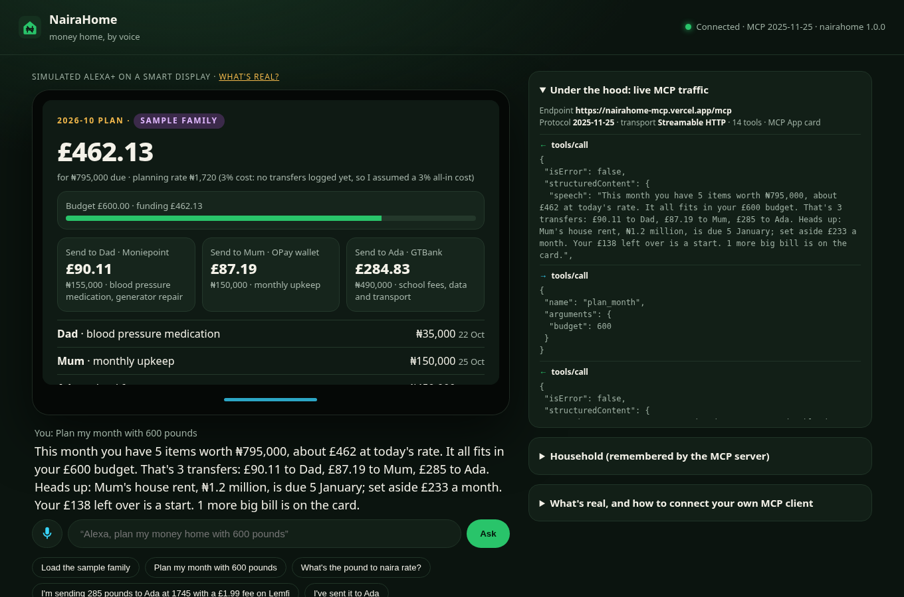
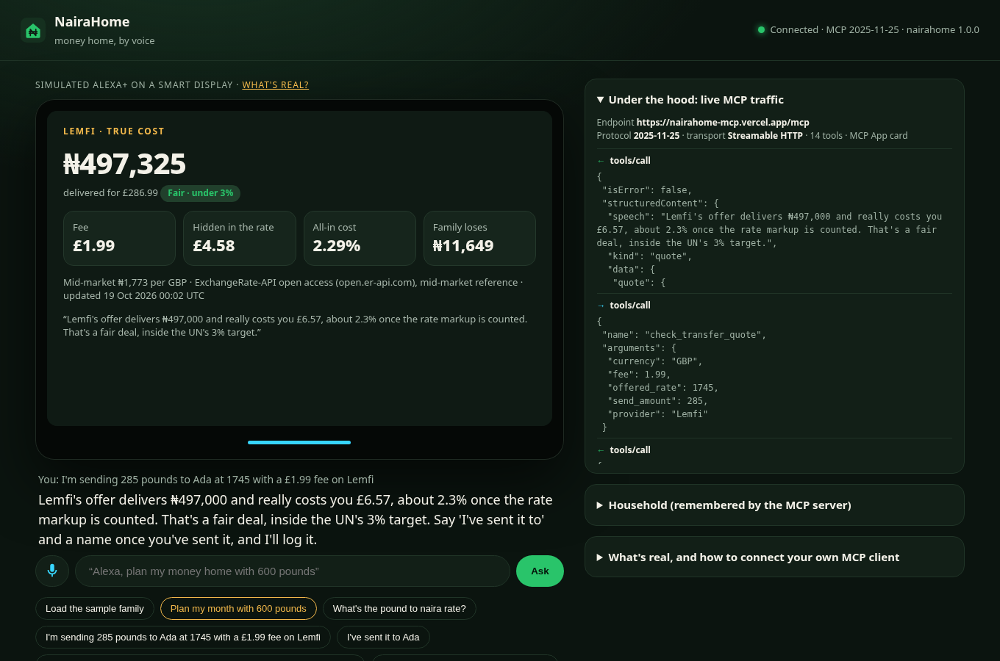
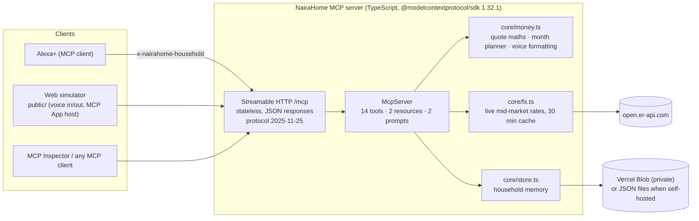

# NairaHome · money home, by voice

**An Alexa+ MCP server that remembers the family you support in Nigeria, prices every transfer against the live naira rate, and plans each month's money home inside your budget.**

- **Track:** Alexa+ · self-hosted MCP server, spec **2025-11-25**, **Streamable HTTP**
- **Live MCP endpoint:** `https://nairahome-mcp.vercel.app/mcp`
- **Try it in a browser (simulated Alexa+ smart display):** https://nairahome-mcp.vercel.app
- **Health:** https://nairahome-mcp.vercel.app/health
- MIT licensed · TypeScript · official MCP TypeScript SDK 1.32.1

> "Alexa, plan my money home with 600 pounds."
> "This month you have 5 items worth ₦795,000, about £462 at today's rate. It all fits in your £600 budget. That's 3 transfers: £90 to Dad, £87 to Mum, £285 to Ada. Heads up: Mum's house rent, ₦1.2 million, is due 5 January; set aside £233 a month."





---

## Why

Millions of Nigerians abroad send money home every month: Mum's upkeep, a sibling's school fees, a parent's medication, the yearly rent. Nigeria is the largest remittance destination in sub-Saharan Africa (World Bank), and the cost of sending it is still well above the UN Sustainable Development Goal target of **3%** (SDG 10.c). Most of that cost isn't the fee you see. It's the markup hidden in the exchange rate.

Today this lives in WhatsApp threads, a notes app and a mental spreadsheet. People:

1. **forget what's due** until a family member calls (school fees, rent, medication);
2. **can't tell what a transfer really costs**, because "zero fees" apps make their money on the rate;
3. **don't plan ahead** for the big bills (annual rent, a new school term), so those become emergencies.

NairaHome is the household memory and the honest calculator, available by voice in the kitchen where these conversations already happen.

## What it does

| Ask Alexa+ | MCP tool | What happens |
|---|---|---|
| "Plan my month with 600 pounds" | `plan_month` | Reads every obligation due this month (and anything overdue), converts at the **live** mid-market rate adjusted by **your real transfer cost learnt from past transfers**, funds essentials first then by due date, groups it into one transfer per person, and flags big bills in the next 6 months with a monthly set-aside. |
| "I'm sending £290 to Ada at 1,745 with a £1.99 fee on Lemfi" | `check_transfer_quote` | Prices the offer **you read off your app** against the live rate: naira delivered, fee, **markup hidden in the rate**, true all-in %, naira your family loses, verdict against the UN 3% target. |
| "Compare Wise at 1,765 fee 3.40 and Lemfi at 1,740 no fee" | `compare_quotes` | Ranks offers by naira delivered per unit paid, fees included. |
| "I've sent it to Ada" | `log_transfer` | Records the transfer, marks Ada's school fees and data allowance paid, rolls them to their next due date (termly = 4 months), and learns your provider's real cost for future plans. |
| "Ada's school fees are 450,000 naira termly, due 28 October" | `add_obligation` | Remembers needs per person: monthly, termly, yearly or one-off; essential or flexible. |
| "Add Tunde, my brother, OPay wallet" | `add_family_member` | Remembers who you support. Refuses account numbers by design. |
| "Tell me when the pound hits 1,810 naira" | `set_rate_alert` / `check_rate_alerts` | Remembers a target; `get_naira_rate` and `plan_month` sessions report when it's hit. |
| "Household summary" | `household_summary` | Who you support, what's next, what you've sent this month/year and how much went on fees and markups. |

Also: `get_naira_rate`, `remove_obligation`, `set_home_currency` (USD, GBP, EUR, CAD), `load_sample_family`, `reset_household` (both destructive, both need `confirm: true`).

**Resources:** `nairahome://household` (JSON) and `ui://nairahome/card.html`, an **MCP App** (`text/html;profile=mcp-app`) that renders rate, quote, compare, plan and summary results as a card for screens like Echo Show. Tools that have a visual answer point at it via `_meta.ui.resourceUri`.

**Prompts:** `monthly_check_in` and `before_i_send`, ready-made agent workflows.

### Designed for voice

- Every tool returns the same envelope in `structuredContent` (validated by an `outputSchema`): a **`speech`** line written to be spoken (₦1.2 million, not ₦1,200,000.00), a `kind` for the card, and `data` for screens.
- Every tool carries MCP **annotations** (`readOnlyHint`, `destructiveHint`, `idempotentHint`, `openWorldHint`) so Alexa+ knows what's safe to call without confirming.
- Tool descriptions tell the model the rules: never invent a provider's rate, ask the user for it.
- State survives sessions. Alexa+ can come back next month and NairaHome still knows Ada's fees roll over on 28 February.

### Honest by construction

- **Live rates only**: the mid-market reference comes from ExchangeRate-API's open endpoint with its timestamp and source in every answer. If the API is down, NairaHome says so and **refuses to guess**.
- **No invented provider prices**: you tell NairaHome what your app shows; it does the maths. A sanity check rejects a rate that's more than 20% off the market (usually the wrong currency).
- **Demo mode is labelled**: `FX_MODE=demo` uses fixture rates for offline work, and every answer then says "Demo mode rate, not a real market price."
- **Sample family is labelled**: `load_sample_family` fills a demo household (Mum, Dad, Ada), flagged `SAMPLE FAMILY` on every card.
- **NairaHome never moves money** and never stores account numbers.

## Architecture



- **Transport:** `WebStandardStreamableHTTPServerTransport` in stateless mode. One server per request, so it runs unchanged on serverless (Vercel), Node, Bun or Workers. `GET`/`DELETE` answer 405 (no standalone SSE stream, no sessions), as the spec allows.
- **Identity:** each household is keyed by the `x-nairahome-household` header (8-64 chars). In a production Alexa+ integration that key would come from account linking/OAuth; for self-hosting, set `NAIRAHOME_TOKEN` to require `Authorization: Bearer …`, and `ALLOWED_ORIGINS` for DNS-rebinding protection.
- **Storage:** `FileStore` (one JSON file per household) locally, `BlobStore` (private Vercel Blob objects) on the hosted demo, `MemoryStore` for tests. Lists are capped (30 people, 100 obligations, 500 transfers, 10 alerts).
- **Planner** (`planMonth`): due + overdue items → planning rate = live mid × (1 − your learnt all-in cost %, or 3% until you've logged a transfer) → greedy fit to budget, essentials first then by due date → group by person → set-asides for ≥ ₦200k bills due in the next 6 months.

### The web simulator (what's real, what's simulated)

Alexa+ MCP integrations are in Preview for selected brands, so the repo ships a **simulated Alexa+ smart display** at `/` (the rules allow this path; it's also the easiest way for judges to try it):

- **Real:** every answer is a JSON-RPC `tools/call` to the MCP server, visible live in the "Under the hood" panel; the browser negotiates protocol `2025-11-25`.
- **Real:** the card on the display is the server's MCP App, fetched with `resources/read` and hosted with the MCP Apps `ui/initialize` → `ui/notifications/tool-result` handshake.
- **Real:** voice in (Web Speech API, Chrome/Edge) and voice out (speech synthesis).
- **Simulated:** Alexa+'s language model. `public/router.js` is a small, tested rule-based intent router with multi-turn slot filling ("What naira rate is your app offering?"). In Alexa+, the model reads the tool descriptions and does this.

## Run it

Requires Node 20+.

```bash
git clone https://github.com/Quantumwoof/nairahome-mcp && cd nairahome-mcp
npm install
npm start                 # http://127.0.0.1:8787  (simulator) and /mcp (MCP endpoint)
FX_MODE=demo npm start    # offline, labelled demo rates
npm test                  # 20 tests: maths, planner, router, full MCP client/server flow
npm run typecheck
npm run smoke -- https://nairahome-mcp.vercel.app/mcp   # end-to-end with the official MCP client
```

### Connect an MCP client

**MCP Inspector** (`npx @modelcontextprotocol/inspector`, v2 needs Node 22+): Transport **Streamable HTTP**, URL `https://nairahome-mcp.vercel.app/mcp`, add header `x-nairahome-household: <any-8-64-char-id>`.

One-liner check:

```bash
npx -y -p node@22 -p @modelcontextprotocol/inspector -- mcp-inspector --cli --transport http \
  --server-url https://nairahome-mcp.vercel.app/mcp --header "x-nairahome-household: my-test-home" \
  --method tools/call --tool-name get_naira_rate --tool-args-json '{"currency":"USD"}'
```

**Any client that takes a remote MCP config** (Kiro, Claude, Cursor, VS Code…):

```json
{
  "mcpServers": {
    "nairahome": {
      "url": "https://nairahome-mcp.vercel.app/mcp",
      "headers": { "x-nairahome-household": "my-test-home" }
    }
  }
}
```

### Deploy your own

Vercel: `vercel link`, `vercel blob create-store nairahome-households --access private`, `vercel deploy --prod`. `vercel.json` serves `public/` and rewrites `/mcp` → `api/mcp.ts`. Anywhere else: `npm start` behind HTTPS with `HOST=0.0.0.0` and `NAIRAHOME_TOKEN` set. See `.env.example`.

## Demo script (under 3 minutes)

See [`docs/demo-script.md`](docs/demo-script.md). Short version on https://nairahome-mcp.vercel.app:

1. **Load the sample family** → card shows Mum, Dad, Ada (flagged SAMPLE).
2. **Plan my month with 600 pounds** → plan card: 3 transfers, rent set-aside, live rate + source. Point at the MCP log.
3. **I'm sending £X to Ada** → "What naira rate is your app offering?" → **"1,745, fee is 1.99, on Lemfi"** → true-cost card (fee + hidden markup + verdict).
4. **I've sent it to Ada** → school fees and data marked paid, rolled to February.
5. **Household summary** → this month's naira delivered and what went on fees and markups.
6. Reload the page (new MCP session) → summary is still there: state across sessions.
7. Run the Inspector one-liner against the same endpoint to show it's a standard MCP server.

## Repo map

```
api/mcp.ts, api/health.ts    Vercel functions (Web Request handlers)
src/http.ts                  MCP endpoint: CORS, auth, household id, stateless Streamable HTTP
src/server.ts                Local Node server (MCP + static simulator)
src/mcp/server.ts            Tools, resources, prompts
src/mcp/card.ts              MCP App (ui://nairahome/card.html)
src/core/                    fx (live rates), money (quotes, planner, voice), store, sample data, types
public/                      Simulated Alexa+ smart display (router.js = intent router)
test/                        node:test suites (unit + MCP client/server integration)
scripts/smoke.ts             End-to-end check against any endpoint
docs/                        Demo script, product feedback and friction log
```

## Limitations and next steps

- Not yet running inside production Alexa+ (Preview access needed); verified with the official MCP client, MCP Inspector and the web simulator.
- Household-id header instead of OAuth account linking; next step is OAuth 2.1 per the MCP authorization spec.
- Rates are a daily mid-market reference, not live provider quotes. A provider-quote integration would need each provider's API and terms.
- Push alerts need Alexa+ proactive notifications; today alerts are reported when you next ask.

## Licence

MIT © 2026 Joshua Jubelo ([@Quantumwoof](https://github.com/Quantumwoof)). Rates by [Exchange Rate API](https://www.exchangerate-api.com).
